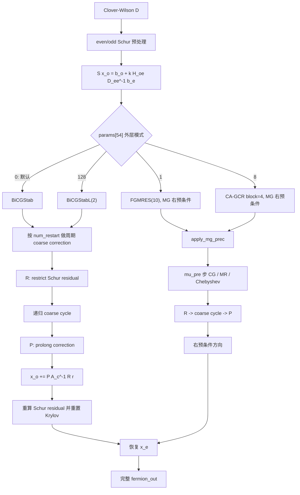
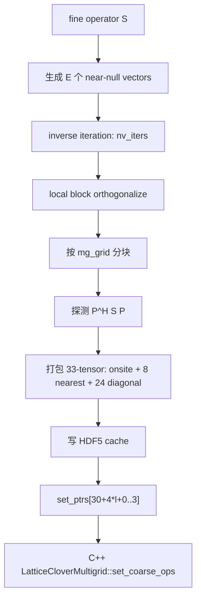
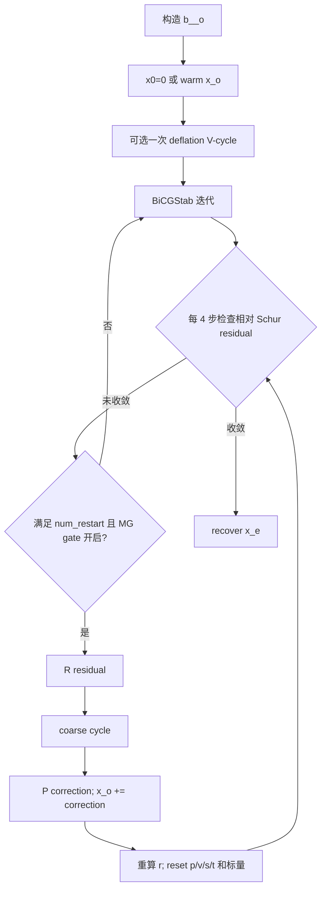
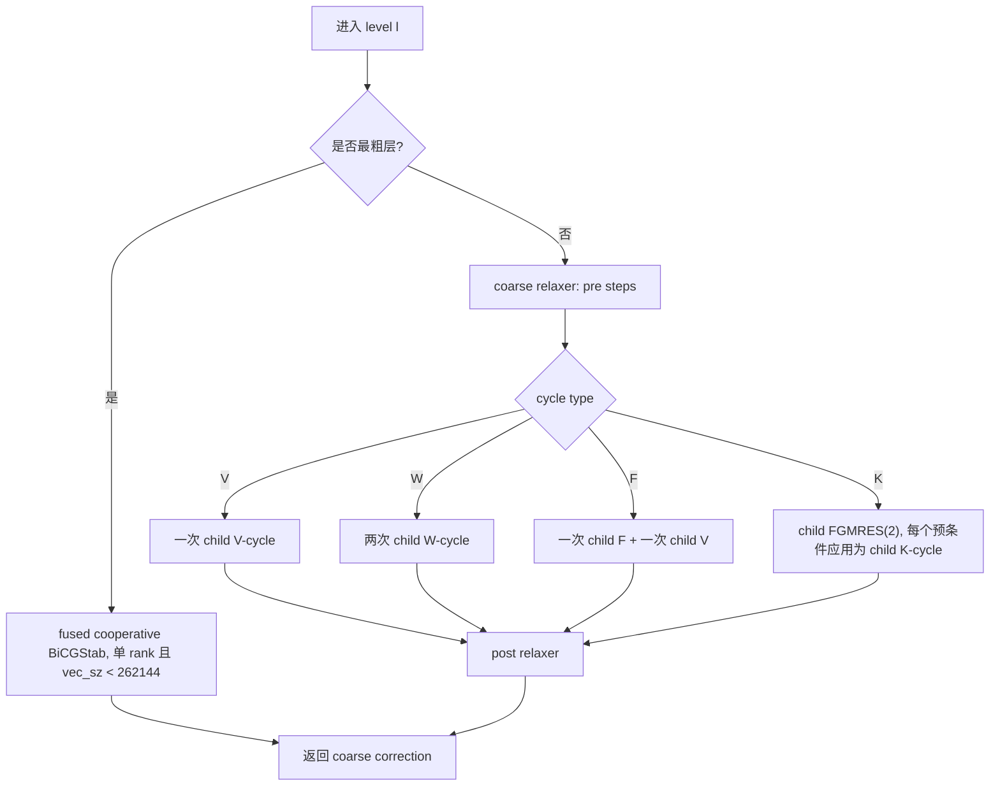
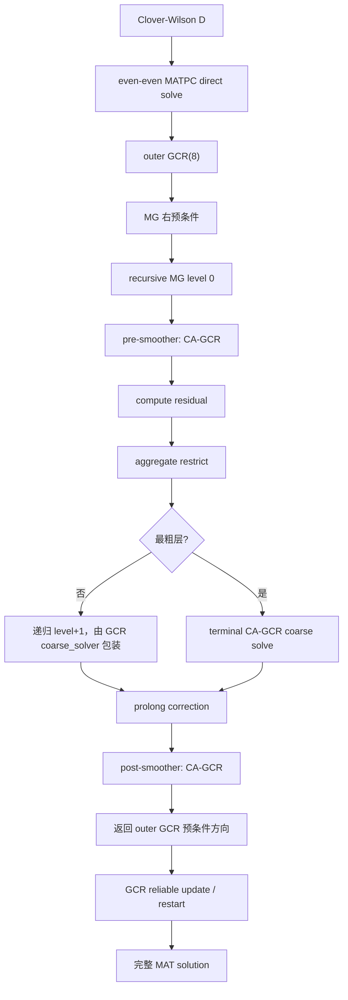
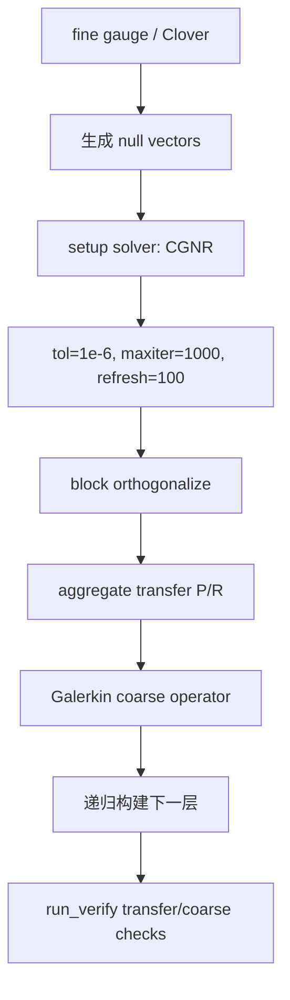
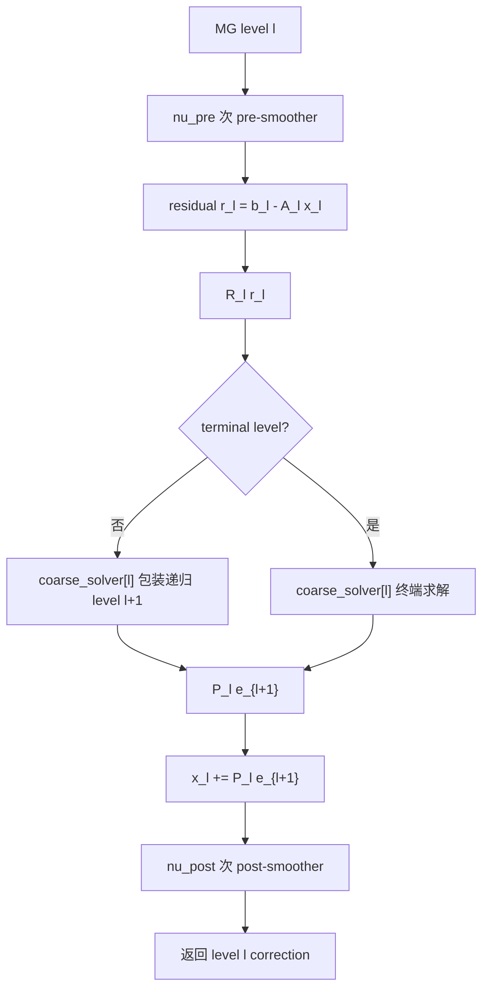

# QCU 与 QUDA MultiGrid 算法组成

本文对比 PyQCU 当前 legacy CUDA MultiGrid 与当前仓库实际使用的 QUDA/PyQUDA
MultiGrid。重点是算法组成和执行顺序，不把 Strict-MG、Python 参考 MG 或 KUPL MG
混入同一口径。

每个子算法的单独流程图、公式、默认配置和同类算法优劣见
[`qcu_quda_multigrid_subalgorithms.md`](qcu_quda_multigrid_subalgorithms.md)。

粗层 dslash 的数据表示，即 legacy 33-tensor 与 Strict/QUDA `X/Y/Yhat` 的区别，
以及“粗化 gauge/clover”这一口径的边界，见
[`qcu_quda_multigrid_coarse_operator.md`](qcu_quda_multigrid_coarse_operator.md)。

CUDA QCU 的生产进程、MPI rank 与设备映射，以及测试专用
`MultiGpuMultigrid` 的边界，见
[`cuda_execution_topology.md`](cuda_execution_topology.md)。

## 口径与版本

| 项 | QCU | QUDA |
|---|---|---|
| 入口 | `applyCloverMultigridQcu` | `quda_multigrid.py` -> PyQUDA -> QUDA |
| 当前主要实现 | `cpp/cuda/qcu/include/lattice_clover_multigrid.h` | 本地 QUDA 1.1.0-sm70 + PyQUDA 0.10.54 |
| fine operator | Clover-Wilson even/odd Schur 补 | Clover-Wilson MATPC even-even direct solve |
| 当前验证模型 | `simple/qcu_multigrid.py` 默认 mode=0 | `simple/quda_multigrid.py` 默认 PyQUDA MG 参数 |

> 本文所述 QCU 是 legacy `applyCloverMultigridQcu`。Strict-MG 使用
> `applyMultigridStrictFgmresQcu`、full-coarse hierarchy、MATPC 和 fused FGMRES，
> 不属于本文比较对象。

## 1. 总体对比

| 组成 | QCU legacy MG | QUDA/PyQUDA MG |
|---|---|---|
| fine preconditioning | odd-site Schur 补 | even-even MATPC |
| 默认 outer solver | BiCGStab | GCR，`gcrNkrylov=8` |
| MG 与 outer 的关系 | 默认是周期 additive coarse correction；FGMRES/CA-GCR 模式下才是右预条件 | MG 作为 GCR 的右预条件 |
| 默认 smoother | 默认 BiCGStab 外层路径无 fine smoother；MG 预条件路径默认固定步 CG | CA-GCR，默认 `nu_pre=0`、`nu_post=8` |
| cycle | 默认 V；可编码 W/F/K | 默认 `QUDA_MG_CYCLE_RECURSIVE` |
| coarse operator | Schur `A_c=P^H S P`，33-tensor stencil | aggregate blocked Galerkin coarse operator |
| 粗层求解 | guarded BiCGStab | 非终端 GCR；终端 CA-GCR |
| 默认粗层预算 | `coarse_max_iter=200`，`coarse_tol_factor=1e4` | `maxiter=16`，`tol=0.25` |
| 真残差保护 | 默认单 rank 每 48 步刷新；FGMRES/CA-GCR 各有 restart/block 真残差 | QUDA reliable update，`reliable_delta=1e-5` |

## 2. 共同记号

细层未预条件 Dirac 算子记为 \(D\)。将自由度分为 even/odd：

\[
D=\begin{pmatrix}D_{ee} & -\kappa H_{eo}\\
-\kappa H_{oe} & D_{oo}\end{pmatrix}.
\]

QCU legacy MG 在 odd Schur 系统上求解：

\[
S=D_{oo}-\kappa^2H_{oe}D_{ee}^{-1}H_{eo},
\qquad
b_{\tilde o}=b_o+\kappa H_{oe}D_{ee}^{-1}b_e.
\]

QUDA 当前入口使用 even-even MATPC direct solve，外层仍返回完整 `MAT_SOLUTION`。

## 3. QCU legacy MG

### 3.1 总体流程



### 3.2 Setup 流程



33-tensor 不是 33 个邻居，而是每个粗格点的矩阵块组成：

- 1 个 onsite block。
- 8 个 nearest-neighbor block，对应 4 个方向的 \(\pm 2\mu\) 连接。
- 24 个 diagonal block，对应方向平面内的对角连接。

参考：

- fine Schur dslash：[`lattice_clover_multigrid.h`](../cpp/cuda/qcu/include/lattice_clover_multigrid.h)
- coarse 33-tensor 说明：[`lattice_clover_multigrid.h`](../cpp/cuda/qcu/include/lattice_clover_multigrid.h)
- Python null-vector/stencil builder：[`_multi_gpu.py`](../pyqcu/cuda/_multi_gpu.py)

### 3.3 Smoother

QCU 的 “smoother” 取决于路径，不能简单说成单一 CG：

| smoother | 更新 | 当前用途 |
|---|---|---|
| CG | 固定 `mu_pre` 步 CG，不做收敛判断 | MG 右预条件的 fine smoother |
| MR | \( \alpha=\langle Ar,r\rangle/\langle Ar,Ar\rangle \)，`x += alpha r`, `r -= alpha Ar` | 可选 fine/coarse relaxer |
| Chebyshev | 固定步多项式；单次 matvec 估计 \(\lambda_{\max}=8\|Ar\|/\|r\|\)，\(\lambda_{\min}=0.05\lambda_{\max}\) | 可选 fine/coarse relaxer |
| 默认粗层 relaxer | guarded BiCGStab | 中间粗层 pre/post smoothing |

`_MG_MU_PRE_` 在 0 时进入 MG 预条件路径回退为 4 步。`apply_mg_prec()` 的固定结构为：

```text
mu_pre 步 CG/MR/Chebyshev
→ restrict
→ 一次递归 coarse cycle
→ prolong
```

该 MG 预条件子没有 fine post-smoothing。剩余高频误差由外层 FGMRES/CA-GCR 处理。

注意：

- 默认 mode=0 的 BiCGStab + 周期粗校正路径不调用 `apply_mg_prec()`，因此
  `_MG_MU_PRE_` 在该默认路径中不参与 fine smoothing。
- `LatticeSap`/SAP kernel 仍存在，但当前主路径没有调用；早期 SAP pre-smoothing
  实验因性能收益不足已停用。

### 3.4 主循环

#### 默认 BiCGStab + 周期粗校正



默认路径包含自适应 correction gate：

1. 先跑 30 次纯 BiCGStab，标定收敛斜率。
2. 每 12 次比较窗口斜率。
3. 若连续两个窗口改善不足 15%，永久关闭后续粗校正。
4. 接近收敛时也跳过粗校正，避免粗层精度地板破坏 Krylov 状态。

单 rank 默认每 48 次迭代用真 Schur 残差刷新状态。源码附近旧注释写“每 50 次”，
实际判断条件是 `total % 48 == 0`，两者不要混淆。

#### BiCGStabL(2)

- 使用固定 \(L=2\) 的 Sleijpen-Fokkema 多项式。
- 每 8 个 cycle 重算真残差并重启短递推。
- 周期 coarse correction 后重置完整 BiCGStabL 状态。
- MR Gram block 奇异或 breakdown 时回退普通 BiCGStab。

#### FGMRES(10)

- 外层为 restarted FGMRES(10)。
- 每个 Arnoldi 方向调用一次 MG 右预条件子。
- 当前路径启动时将 `x=0`，没有消费 `_MG_USE_INIT_GUESS_` 热启动。
- 预条件子门控在连续窗口因子不优于 0.9 时退化为 identity preconditioner。

#### CA-GCR

- block=4 的 communication-avoiding GCR。
- 同样使用 MG 右预条件。
- 每个 block 重算真残差。
- 小 Gram 系统 breakdown 时回退 FGMRES。

### 3.5 递归 coarse cycle



实际 pre/post 步数：

- 冷粗解：总步数为该层 `max_iter`，前后各一半。
- 已有粗解：总步数 64，pre=32、post=32。

默认 2-level 时，level 1 已是最粗层，因此 W/F/K 不会产生差异；cycle 选择主要对
3 层及以上有意义。

### 3.6 最粗层求解器

QCU 最粗层不是 CG，而是 guarded BiCGStab：

- 单 rank 且 `vec_sz < 262144`：单个 cooperative kernel 内完成完整 BiCGStab。
- 其他情况：每 8 次迭代一个 Graph replay 段，段末检查残差。
- 多 rank：关闭 fused cooperative 和 CUDA Graph，使用 MPI halo 与全局归约。
- 粗解支持 warm start；目标以首次进入该层时的 `||rhs||` 为锚。
- 粗 RHS 小于 `1e-4` 时直接跳过。
- breakdown 时丢弃粗校正并回退 fine Krylov。

函数名 `multigrid_coarse_solve_cg` 中的 `cg` 是历史命名；内部实际是 BiCGStab。

### 3.7 `simple/qcu_multigrid.py` 的实际默认

该脚本默认配置：

```text
levels = 2
dof = [12, 48]
mg_grid = [2,2,2,2]
restart = 5
coarse_max_iter = 200
coarse_tol_factor = 1e4
params[54] = 0
params[55] = 0  # deflate off
params[56] = 0  # mu_pre default only used by MG preconditioner path
params[57] = 0  # cold start
```

因此默认执行的是：

```text
Schur BiCGStab
+ 每 5 次迭代候选一次 coarse correction
+ 30 步标定与自适应 correction gate
+ coarse BiCGStab
```

不是外层 FGMRES，也不是 CA-GCR。

## 4. QUDA/PyQUDA MG

### 4.1 总体流程



### 4.2 Setup 流程



当前 PyQUDA 构造值：

- `setup_inv_type=CGNR`。
- `setup_tol=1e-6`。
- `setup_maxiter=1000`。
- `setup_maxiter_refresh=100`。
- `n_vec_batch=1`。
- `num_setup_iter=1`。
- `setup_type=NULL_VECTOR_SETUP`。
- `post_orthonormalize=true`。
- `generate_all_levels=true`。
- `run_verify=true`。
- `transfer_type=AGGREGATE`。

### 4.3 Fine preconditioning 与主循环

PyQUDA 当前构造：

- outer `inv_type=GCR`。
- `inv_type_precondition=MG`。
- `gcrNkrylov=8`。
- `tol_precondition=0.25`。
- `maxiter_precondition=16`。
- `precondition_cycle=1`。
- `schwarz_type=ADDITIVE_SCHWARZ`。
- `omega=1.0`。
- `solve_type=DIRECT_PC_SOLVE`。
- `matpc_type=EVEN_EVEN`。
- `solution_type=MAT_SOLUTION`。
- `residual_type=L2_RELATIVE`。
- `tol_restart=5000*tol`。
- `reliable_delta=1e-5`。
- `use_init_guess=NO`。

外层 GCR 的每次 Krylov 方向由一次 MG cycle 预条件。当前 simple 驱动还把
`mass_normalization` 强制为 `QUDA_KAPPA_NORMALIZATION`，以便与 PyQCU 的
`M=I-kappa D` 口径一致。

### 4.4 QUDA cycle



PyQUDA 当前默认：

```text
cycle_type[level] = RECURSIVE
nu_pre[level] = 0
nu_post[level] = 8
omega[level] = 1.0
smoother[level] = CA-GCR
smoother_tol[level] = 0.25
```

因此默认不是 QCU 的 V-cycle 固定节奏，而是 QUDA 的 recursive cycle 实现；每层
默认只有 8 次 post-smoothing，没有 pre-smoothing。

### 4.5 QUDA smoother

当前 smoother 是 CA-GCR，不是 MR，也不是 plain CG。CA-GCR 属于
communication-avoiding GCR，使用块 Krylov 方向并减少全局同步；它在每一层通过
`smoother` 字段独立配置。

重要区别：

- QCU 的默认 2-level 粗校正路径不调用 fine MG 预条件 smoother。
- QUDA 的默认 outer GCR 一定通过 MG 预条件，且每层执行 CA-GCR smoother。
- QUDA 当前 `nu_pre=0`，所以“pre-smoother”默认不执行；`nu_post=8` 才执行。

### 4.6 QUDA coarse solver

PyQUDA 构造的 `coarse_solver` 数组默认：

- 非终端层：GCR。
- 终端粗层：CA-GCR。
- `coarse_solver_tol=0.25`。
- `coarse_solver_maxiter=16`。

其含义是“包装 coarse-grid correction 和 smoother 的求解器”，不是 QCU 的单一
guarded BiCGStab。QUDA 的 recursive hierarchy 会在每层组合该 wrapper、transfer、
smoother 和下一层 cycle。

### 4.7 QUDA 默认 block/null-space 参数

`simple/quda_multigrid.py` 当前传入：

- `levels` 默认 2。
- `--block 2 2 2 2` 作为 transition block。
- PyQUDA 自动追加终端块 `[4,4,4,4]`。
- `nvec=24`，可由 `--nvec` 覆盖。
- fine `spin_block_size=2`。
- coarse `spin_block_size=1`。
- coarse spin=2。
- coarse color=`2*nvec=48`。

这两个 block 配置共同决定 coarse lattice 和 `DiracCoarse` 的 spin/color 结构。

## 5. 并排算法对照

| 维度 | QCU legacy MG | QUDA/PyQUDA MG |
|---|---|---|
| fine system | odd Schur \(S\) | even-even MATPC |
| outer solver | 默认 BiCGStab；可选 BiCGStabL/FGMRES/CA-GCR | GCR(8) |
| MG 角色 | 默认 additive periodic correction；部分模式为右预条件 | GCR 的右预条件 |
| cycle | V/W/F/K；默认 V | recursive |
| pre-smoother | MG 预条件路径为固定步 CG/MR/Cheb；周期校正路径无 fine pre-smooth | CA-GCR，默认 0 步 |
| post-smoother | 粗中间层有 coarse relaxer；MG 预条件无 fine post-smooth | CA-GCR，默认 8 步 |
| coarse relaxer | guarded BiCGStab | 由 `coarse_solver` 配置；默认非终端 GCR |
| terminal solver | fused/segmented guarded BiCGStab | CA-GCR，maxiter=16, tol=0.25 |
| coarse operator | 33-tensor Schur Galerkin | aggregate Galerkin |
| setup | inverse iteration + orthogonalize + local stencil | CGNR null vectors + block orthogonalize + recursive Galerkin |
| fine starts | 默认 BiCGStab 路径可清空；支持 warm-start 模式 | 当前 simple 强制 NO init guess |
| reliable residual | 48-step single-rank refresh；GCR/FGMRES block/restart 真残差 | `reliable_delta=1e-5` 的 reliable update |
| verification | coarse op/restriction checks、Python true residual | `run_verify=true`、transfer/coarse checks |

## 6. 如何解读

### QCU

当前 `simple/qcu_multigrid.py` 的默认不是“QUDA-style GCR + CA-GCR smoother”。它是：

```text
Schur BiCGStab
  + 周期 additive coarse correction
  + coarse guarded BiCGStab
  + adaptive correction gate
```

如果需要 QUDA-style MG 预条件，需要显式设置 `_MG_USE_GCR_` 的 FGMRES 或 CA-GCR
模式，并配置 `_MG_MU_PRE_`、smoother 和 cycle 位；不能仅凭 `levels>1` 推断。

### QUDA

当前 PyQUDA simple 路径的默认不是 QCU 的 BiCGStab + correction。它是：

```text
MATPC direct solve
  → outer GCR(8)
  → MG recursive preconditioner
      → level CA-GCR smoother, nu_pre=0/nu_post=8
      → coarse GCR wrapper
      → terminal CA-GCR coarse solve
```

因此两者即使 coarse color 都可能是 48，外层 Krylov、MG 作用方式、smoother 和
粗层 terminal solver 都不同，不能按“同为 MG”直接对比迭代数。

## 7. 关键源码与配置依据

### QCU

- fine Schur dslash：[`lattice_clover_multigrid.h`](../cpp/cuda/qcu/include/lattice_clover_multigrid.h)
- 33-tensor coarse operator：[`lattice_clover_multigrid.h`](../cpp/cuda/qcu/include/lattice_clover_multigrid.h)
- mode bit 解析：[`lattice_clover_multigrid.h`](../cpp/cuda/qcu/include/lattice_clover_multigrid.h)
- coarse V/W/F/K：[`lattice_clover_multigrid.h`](../cpp/cuda/qcu/include/lattice_clover_multigrid.h)
- 默认 BiCGStab + correction gate：[`lattice_clover_multigrid.h`](../cpp/cuda/qcu/include/lattice_clover_multigrid.h)
- fixed-step CG/MR/Chebyshev MG preconditioner：[`lattice_clover_multigrid.h`](../cpp/cuda/qcu/include/lattice_clover_multigrid.h)
- FGMRES：[`lattice_clover_multigrid.h`](../cpp/cuda/qcu/include/lattice_clover_multigrid.h)
- CA-GCR：[`lattice_clover_multigrid.h`](../cpp/cuda/qcu/include/lattice_clover_multigrid.h)
- simple default parameters：[`qcu_multigrid.py`](../pyqcu/testing/simple/qcu_multigrid.py)

### QUDA/PyQUDA

- 本地 QUDA `QudaMultigridParam` 定义：
  `data/quda-sm70-install/include/quda.h:629`
- 本地 QUDA per-level `MGParam`：
  `data/quda-sm70-install/include/multigrid.h:85`
- PyQUDA 0.10.54 默认 MG 构造：
  `pyquda/dirac/general.py:283`
- PyQUDA outer GCR/MG preconditioner：
  `pyquda/dirac/general.py:408`
- PyQUDA 参数写入入口：
  `pyquda/dirac/general.py:479`
- simple wrapper：
  [`quda_multigrid.py`](../pyqcu/testing/simple/quda_multigrid.py)

## 8. 版本边界

QUDA 的 MG 默认参数和 CA-GCR 实现会随 QUDA/PyQUDA 版本变化；本文记录的是当前仓库
`quda-sm70-install` 的 QUDA `1.1.0-sm70` 与 PyQUDA `0.10.54`。更新安装树或修改
`newQudaMultigridParam()`/`Multigrid.setParam()` 后，必须重新生成本文表格和流程图，
不能把旧默认继续写成“当前”。
