# QCU 与 QUDA MultiGrid 子算法详解

本文是 [`qcu_quda_multigrid_algorithms.md`](qcu_quda_multigrid_algorithms.md) 的
展开版，对当前 QCU legacy MG 与当前 QUDA/PyQUDA MG 的主要子算法逐项给出：

- Mermaid 算法流程图。
- 数学摘要与关键递推式。
- 当前实现中的默认配置或有效路径。
- 与同类算法的优劣比较。

## 口径与公式约定

- QCU：`applyCloverMultigridQcu`，不包含 Strict-MG。
- QUDA：仓库 `simple/quda_multigrid.py` 经 PyQUDA 0.10.54 构造的参数，链接本地
  QUDA 1.1.0-sm70。
- 标量积定义为

$$
\langle x,y\rangle = x^{H}y,
\qquad
\|x\|_2^2 = \langle x,x\rangle.
$$

- 除特别说明外，向量均为当前层的 rank-local 向量；MPI 下点积和范数做全局归约。
- 公式使用 Markdown LaTeX：行内公式写作 `$...$`，独立公式写作 `$$ ... $$`。

## 1. 子算法总表

| 组件 | QCU 当前组成 | QUDA/PyQUDA 当前组成 |
|---|---|---|
| fine preconditioning | odd-site Schur 补 | even-even MATPC |
| null space | inverse-iteration filtering + local QR | CGNR null-vector setup + block orthonormalization |
| transfer | null-vector restriction/prolongation | aggregate transfer |
| coarse operator | Schur Galerkin 33-tensor | aggregate Galerkin |
| smoother | CG/MR/Chebyshev；默认路径另用粗层 BiCGStab | CA-GCR |
| outer Krylov | BiCGStab、BiCGStabL(2)、FGMRES(10)、CA-GCR | GCR(8) |
| cycle | V/W/F/K，默认 V | recursive |
| coarse wrapper | fused/segmented guarded BiCGStab | GCR；终端 CA-GCR |
| reliable correction | 48-step single-rank refresh；gate；deflation | reliable update；setup/coarse verification |

# 第一部分：QCU legacy MG

## A1. Even/Odd Schur 预处理

### 流程图

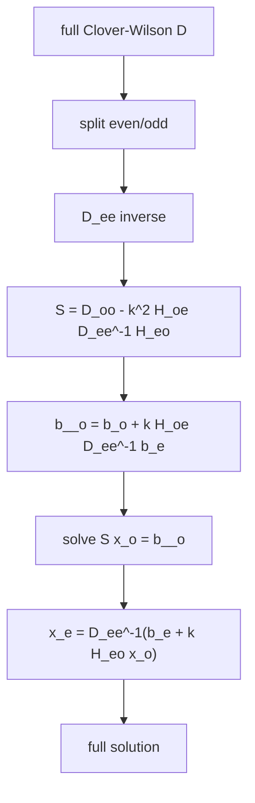

### 算法摘要

QCU 将 full Dirac 系统约化为 odd-site Schur 补：

$$
S = D_{oo} - \kappa^2 H_{oe}D_{ee}^{-1}H_{eo},
$$

$$
b_{\tilde o} = b_o + \kappa H_{oe}D_{ee}^{-1}b_e.
$$

求出 odd 解 $x_o$ 后恢复 even 部分：

$$
x_e = D_{ee}^{-1}\left(b_e + \kappa H_{eo}x_o\right).
$$

### 同类算法优劣

| 方案 | 优点 | 缺点 |
|---|---|---|
| Schur odd solve | Krylov 向量规模约减半；显式利用 Clover block inverse；适合 GPU | 需要保存 $D_{ee}^{-1}$；每次 matvec 包含两次 hop 和一次 even 反解；最终 full residual 需额外重构 |
| Full Dirac solve | 实现直接；真残差容易计算；无 Schur 重构误差 | 向量规模翻倍；谱通常更分散；Krylov 成本更高 |
| 其他 parity preconditioning | 可针对时间或空间 parity 优化通信 | 与当前时间压缩布局和 C++ ABI 不一致 |

### 当前采用

- level 0 始终求解 odd Schur 系统。
- 粗空间也从 Schur operator 的低模构造，不沿用 full-D 粗空间。
- 最终通过 `recover_x_e()` 返回 full solution。

## A2. QCU Null-Vector 生成

### 流程图

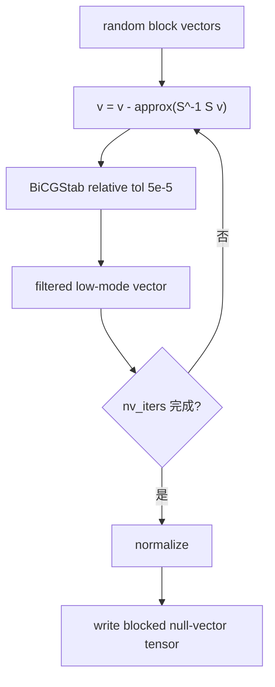

### 算法摘要

QCU 对随机块 $v_i$ 做近似低模过滤：

$$
y_i \approx S^{-1}(S v_i),
\qquad
v_i \leftarrow v_i-y_i.
$$

内部用相对容差约 $5\times10^{-5}$ 的 BiCGStab 求 $y_i$，避免把逆迭代推到舍入噪声区。
之后执行 local block QR，使每个 coarse aggregate 的 null-vector block 正交。

### 同类算法优劣

| 方案 | 优点 | 缺点 |
|---|---|---|
| Approx. inverse iteration | 实现简单；能直接针对当前 Schur 谱 | 需多次近似 solve；setup 可很贵；逆迭代过精确会产生噪声向量 |
| Lanczos/Ritz | 对孤立低模最精确；适合 deflation | setup 更复杂；多向量成本高；对连续谱不一定优于 filtering |
| 纯随机 null vectors | 便宜 | 粗空间质量差，Galerkin 粗算子常不能有效降残差 |
| 解析/物理猜测向量 | 对近自由场可能便宜有效 | 在真实组态和连续谱上不稳健 |

### 当前采用

- `nv_iters` 控制 inverse-iteration 次数。
- `PYQCU_MG_LOCAL_STENCIL` 或自动阈值决定后续 stencil 的构造方式。
- null vectors 和 stencil 可联合缓存，避免重复 setup。

## A3. QCU Local Block Orthogonalization

### 流程图

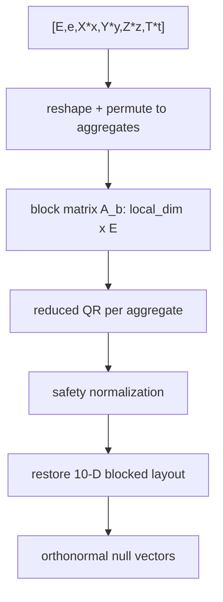

### 算法摘要

每个 coarse aggregate 内的矩阵 $A_b$ 使用 reduced QR：

$$
A_b=Q_bR_b,
\qquad
Q_b^{H}Q_b=I_E.
$$

目标是让 prolongation/restriction 在同一 aggregate 内近似满足

$$
P^{H}P \approx I.
$$

### 同类算法优劣

| 方案 | 优点 | 缺点 |
|---|---|---|
| Local block QR | 批处理；GPU 并行好；每个 aggregate 独立 | 只保证局部正交；跨 aggregate 不形成全局正交基 |
| Global Gram-Schmidt | 全局正交性明确 | 通信多；大块 QR 成本高；GPU 核数量多 |
| 修改 Gram-Schmidt | 数值稳定性可调 | 多次 pass；实现和同步成本高 |
| 不正交化 | 最便宜 | $P^HP$ 病态；粗算子和 prolongation 不稳定 |

### 当前采用

- 每个 coarse block 做本地 QR。
- KUPL builder 对严重退化情形会再做一次 global-layout QR。
- 最终检查 null-vector block 的 Gram 误差。

## A4. QCU 33-Tensor Galerkin 粗算子

### 流程图

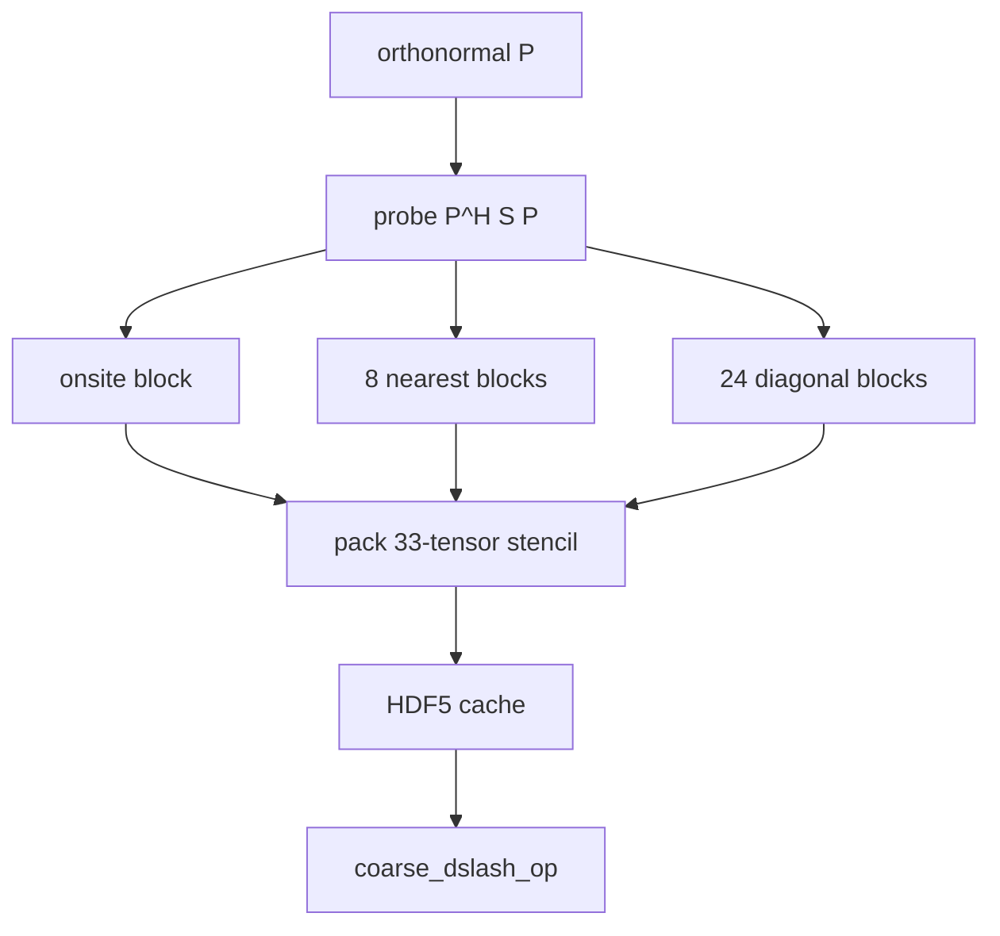

### 算法摘要

粗算子是 Schur 算子的 Galerkin 投影：

$$
A_c=P^{H}SP.
$$

$A_c$ 保存 1 个 onsite、8 个 nearest 和 24 个 diagonal，共 33 个
$E\times E$ block。

### 同类算法优劣

| 方案 | 优点 | 缺点 |
|---|---|---|
| 33-tensor Galerkin | 保持 Schur 低模；粗层算子精确；缓存后启动快 | cache 大；构造探测昂贵；stencil 固定且需 MPI halo |
| Rediscretized coarse operator | 结构简单，可直接用几何粗化 | 不保证表示 $P^HSP$；可能丢失重要谱信息 |
| Dense coarse matrix | 调试容易，可任意连接 | 存储和带宽爆炸；不适合 4D 格点 |
| Matrix-free $P^HSP$ | 内存少 | 每次粗 matvec 仍访问细层，完全失去 MG 成本优势 |

### 当前采用

- 默认 coarse E 由 `dof[level]` 指定。
- `simple/qcu_multigrid.py` 默认 level-1 E=48。
- cache 以 lattice、mass、csw、dof、mg-grid、nv-iters、seed 等身份区分。

## A5. QCU Restriction 与 Prolongation

### 流程图

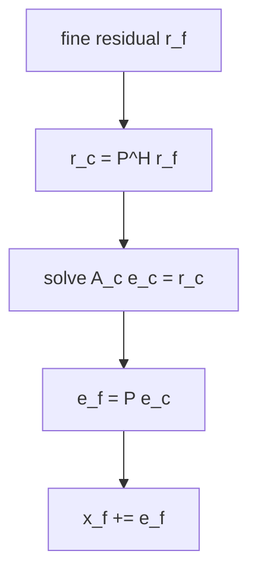

### 算法摘要

restriction 和 prolongation 互为伴随：

$$
r_c=P^{H}r_f,
\qquad
e_f=Pe_c.
$$

粗校正为：

$$
x_f\leftarrow x_f+P A_c^{-1}P^{H}r_f.
$$

### 同类算法优劣

| 方案 | 优点 | 缺点 |
|---|---|---|
| Null-vector R/P | 与粗空间定义一致；R 和 P 可严格伴随 | 局部正交不等于全局正交，仍可能出现谱退化 |
| Geometric block averaging | 便宜；通信规则简单 | 对低模不最优；Dirac 自旋结构处理生硬 |
| Smoothed aggregation | 粗空间质量通常更好 | 需要额外 smoothing 和 setup |
| Injection/projection | 极便宜 | 信息损失大，常导致粗校正质量差 |

### 当前采用

- QCU 使用 null-vector block 的 conjugate projection 做 R。
- 同一 null-vector block 做 P。
- `verify_restriction_prolongation()` 检查伴随关系。

## A6. Fixed-Step CG Smoother

### 流程图

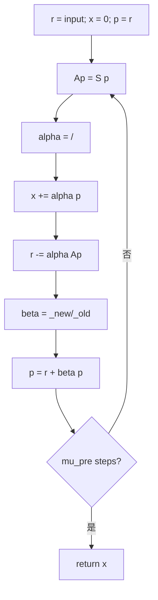

### 算法摘要

固定步 CG 递推：

$$
\alpha_k=\frac{\langle p_k,r_k\rangle}
{\langle p_k,Sp_k\rangle},
$$

$$
x_{k+1}=x_k+\alpha_kp_k,
\qquad
r_{k+1}=r_k-\alpha_kSp_k,
$$

$$
\beta_k=\frac{\langle r_{k+1},r_{k+1}\rangle}
{\langle r_k,r_k\rangle},
\qquad
p_{k+1}=r_{k+1}+\beta_kp_k.
$$

当前实现固定执行 `mu_pre` 步，不在 smoother 内判断收敛，因此没有每步 host 同步。

### 同类算法优劣

| 方案 | 优点 | 缺点 |
|---|---|---|
| 固定步 CG | 每步一次 matvec；适合 Hermitian 正定或近 HPD；实现简单 | 对非 Hermitian/强非正规算子可能失去单调性；固定步数可能过度或不足 |
| MR | 残差局部最优；不要求 HPD | 每步仍需点积；对非常困难的谱可能收敛慢 |
| Chebyshev | 固定多项式，无点积；通信少 | 依赖谱界估计；估计差时效果不稳定 |
| SAP/Schwarz | 局部性好，可强平滑 | 边界/颜色和并行实现复杂；历史实验未显示收益 |

### 当前采用

- `_MG_MU_PRE_ <= 0` 时用 4 步。
- 只在 FGMRES/CA-GCR 的 `apply_mg_prec()` 路径中使用。
- 默认 mode=0 的 BiCGStab + 周期粗校正路径不调用此算法。

## A7. MR Smoother

### 流程图

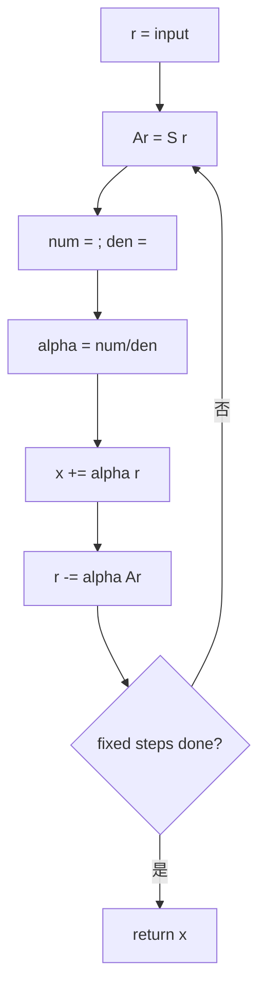

### 算法摘要

QCU 的固定步 MR 使用当前残差作为搜索方向：

$$
\alpha_k=
\frac{\langle Ar_k,r_k\rangle}
{\langle Ar_k,Ar_k\rangle},
$$

$$
x_{k+1}=x_k+\alpha_kr_k,
\qquad
r_{k+1}=r_k-\alpha_kAr_k.
$$

### 同类算法优劣

| 方案 | 优点 | 缺点 |
|---|---|---|
| MR | 不要求 HPD；对非正规粗算子更稳健；固定步易于 GPU 实现 | 只做残差方向局部极小化；可能不如 Krylov 子空间算法快 |
| CG | 对 HPD 收敛更快 | 非 HPD 时可能停滞或发散 |
| Chebyshev | 无点积、通信少 | 需要可信谱界 |
| CA-GCR | 块 Krylov，抑制同步 | 状态和内存更大，实现更复杂 |

### 当前采用

- 由 `_MG_MODE_MR_SMOOTHER_` 选择。
- 粗层 MR 固定步；fine MG 预条件 MR 固定 `mu_pre` 步。
- 与 Chebyshev 互斥。

## A8. Chebyshev Smoother

### 流程图

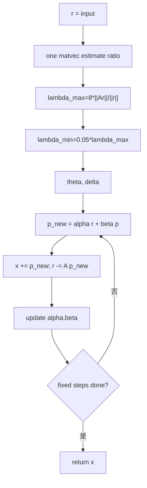

### 算法摘要

当前实现先估计

$$
\lambda_{\max}=8\frac{\|Ar\|_2}{\|r\|_2},
\qquad
\lambda_{\min}=0.05\lambda_{\max}.
$$

令

$$
\theta=\frac{\lambda_{\max}+\lambda_{\min}}{2},
\qquad
\delta=\frac{\lambda_{\max}-\lambda_{\min}}{2},
$$

递推为

$$
p_{k+1}=\alpha_kr_k+\beta_kp_k,
\qquad
x_{k+1}=x_k+p_{k+1},
$$

$$
r_{k+1}=r_k-Ap_{k+1},
$$

$$
\beta_{k+1}=\left(\frac{\delta\alpha_k}{2}\right)^2,
\qquad
\alpha_{k+1}=\frac{1}{\theta-\beta_{k+1}}.
$$

### 同类算法优劣

| 方案 | 优点 | 缺点 |
|---|---|---|
| Chebyshev | 无内积；GPU 通信低；固定成本可控 | 依赖谱界；QCU 使用单次采样近似，非严格上界；对非正规谱风险更高 |
| CG | 无谱界需求 | 非 HPD 时不稳健；每步有点积 |
| MR | 残差局部最优；更稳健 | 仍需点积 |
| CA-GCR | 块方向更稳健 | 内存和计算更高 |

### 当前采用

- 由 `_MG_MODE_CHEBYSHEV_` 选择。
- fine 和 coarse 各有独立实现。
- 非有限更新会被 kernel 拒绝，保持上一有效向量。
- 与 MR 互斥。

## A9. QCU 默认 BiCGStab 主循环

### 流程图

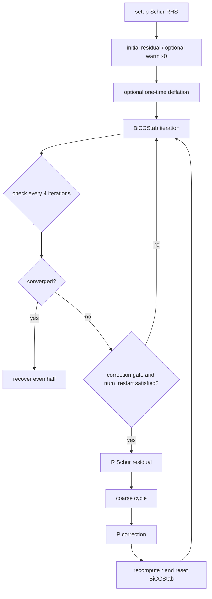

### 算法摘要

标准 BiCGStab 递推为

$$
\rho_i=\langle\tilde r,r_i\rangle,
\qquad
\beta_i=\frac{\rho_i}{\rho_{i-1}}\frac{\alpha_{i-1}}{\omega_{i-1}},
$$

$$
p_i=r_i+\beta_i(p_{i-1}-\omega_{i-1}v_{i-1}),
\qquad
v_i=Sp_i,
$$

$$
\alpha_i=\frac{\rho_i}{\langle\tilde r,v_i\rangle},
\qquad
s_i=r_i-\alpha_iv_i,
$$

$$
t_i=Ss_i,
\qquad
\omega_i=\frac{\langle t_i,s_i\rangle}{\langle t_i,t_i\rangle},
$$

$$
x_{i+1}=x_i+\alpha_ip_i+\omega_is_i,
\qquad
r_{i+1}=s_i-\omega_it_i.
$$

每 `num_restart` 次候选一次粗校正：

$$
x_o\leftarrow x_o+P A_c^{-1}P^{H}r,
$$

之后必须重算 $r$ 并重置 $p,v,s,t,\rho,\alpha,\omega$。

### 同类算法优劣

| 方案 | 优点 | 缺点 |
|---|---|---|
| BiCGStab | 短递推；内存低；对非 Hermitian 常用 | breakdown 风险；与非定常 MG 校正结合时必须频繁重置 |
| GCR/FGMRES | 对变预条件更稳健，残差通常单调 | Krylov 基内存更大，正交化成本更高 |
| BiCGStabL | 短多项式可改善困难谱 | 实现复杂，Gram block 可能奇异 |
| CG | HPD 上更便宜 | 不适用于一般 non-Hermitian Schur 系统 |

### 当前采用

- `params[54]=0` 的默认路径。
- 每 4 次迭代检查一次相对 Schur 残差。
- 粗校正受 `num_restart`、30 步标定 gate 和近收敛跳过条件共同控制。
- 单 rank 每 48 次迭代刷新真 Schur 残差。

## A10. BiCGStabL(2)

### 流程图

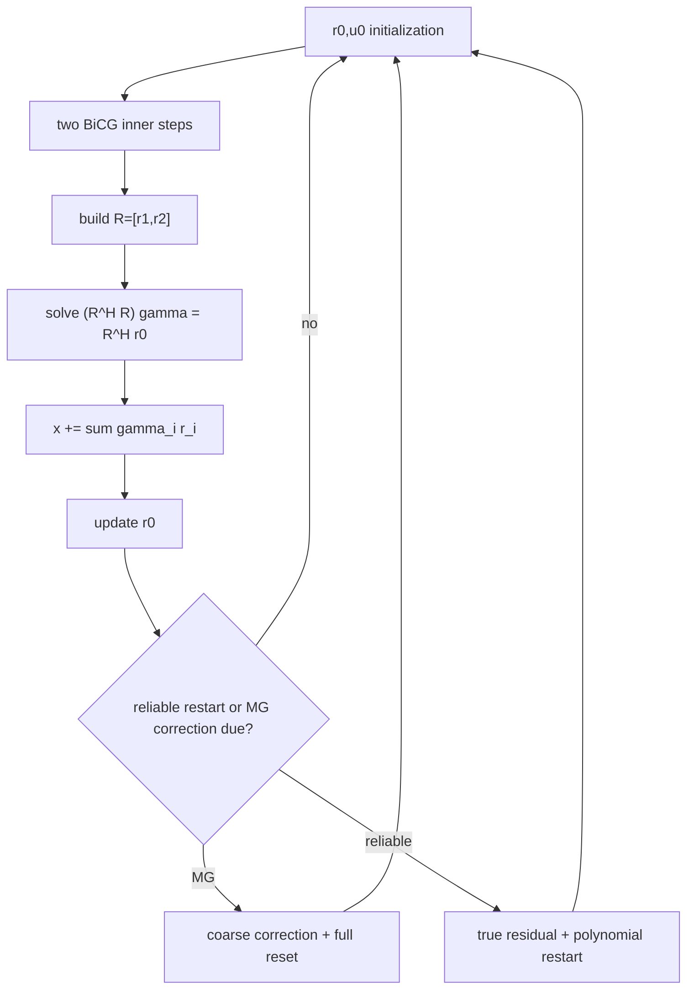

### 算法摘要

BiCGStab(2) 先构造两个 BiCG residual，再用 MR 多项式组合。令

$$
R=[r_1,r_2],
$$

求解最小问题

$$
\min_{\gamma}\|r_0-R\gamma\|_2.
$$

对应正规方程

$$
(R^{H}R)\gamma=R^{H}r_0.
$$

然后更新

$$
x\leftarrow x+R\gamma,
\qquad
r_0\leftarrow r_0-R\gamma.
$$

### 同类算法优劣

| 方案 | 优点 | 缺点 |
|---|---|---|
| BiCGStabL(2) | 短递推；对某些困难谱优于普通 BiCGStab | Gram block 可能病态；状态更多；需 reliable restart |
| BiCGStab | 实现简单、内存更低 | 多项式阶数低，可能收敛较慢 |
| FGMRES/CA-GCR | 对变预条件更稳健 | 内存和正交化开销更高 |

### 当前采用

- 由 `_MG_MODE_BICGSTABL_` 选择。
- 每 8 个 cycle 做 true-residual restart。
- MG correction 后清空短多项式状态。
- breakdown 超过阈值时回退普通 BiCGStab。

## A11. FGMRES(10) + MG 右预条件

### 流程图

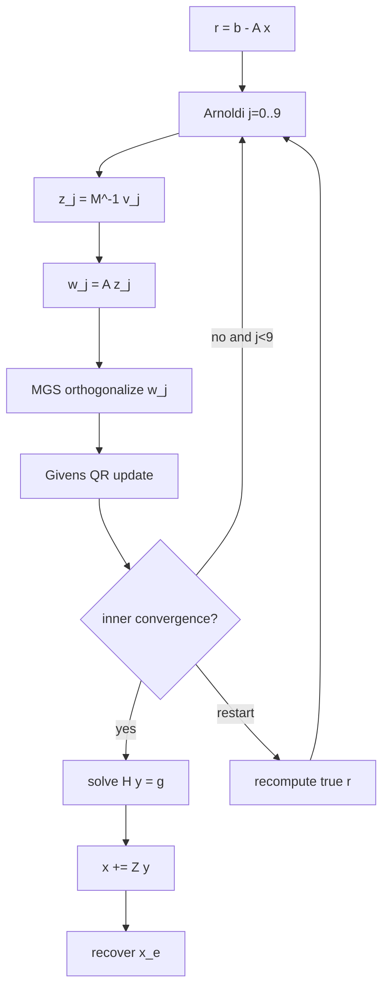

### 算法摘要

FGMRES 每次 Arnoldi 方向使用可能变化的预条件子：

$$
z_j=M_j^{-1}v_j,
\qquad
w_j=Az_j.
$$

构造

$$
AZ_m=V_{m+1}\bar H_m,
$$

解最小二乘

$$
y_m=\arg\min_y\left\|\beta e_1-\bar H_my\right\|_2,
\qquad
x_m=x_0+Z_my_m.
$$

### 同类算法优劣

| 方案 | 优点 | 缺点 |
|---|---|---|
| FGMRES | 允许每步不同预条件；比 GCR/BiCGStab 更稳健 | 保存 $V$ 和 $Z$，内存大；MGS/Givens 成本高 |
| GCR | 天然适合右预条件；残差性质好 | 像 FGMRES 一样需要 Krylov 基；正交化昂贵 |
| BiCGStab | 内存低 | 变预条件会破坏短递推，需要频繁 reset |
| CA-GCR | 降低同步，适合大规模并行 | 实现复杂，块 Gram 可能病态 |

### 当前采用

- `_MG_MODE_GCR_` 实际选择 FGMRES(10)。
- 每个 Arnoldi 方向执行一次 `apply_mg_prec()`。
- MG 预条件为固定 `mu_pre` 步 CG/MR/Cheb + 一次 coarse cycle，无 fine post-smooth。
- 预条件子无改善时可通过 gate 退化为 identity。

## A12. CA-GCR

### 流程图

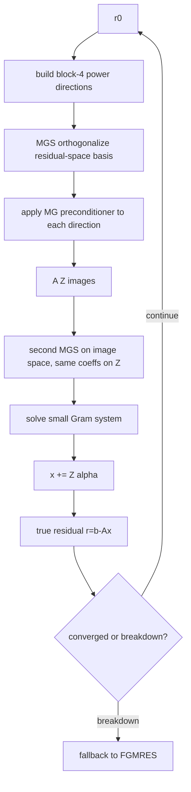

### 算法摘要

CA-GCR 每块产生 $m=4$ 个方向。先正交化 raw directions：

$$
Z=R\Gamma,
$$

再对 image directions 做 GCR 正交化：

$$
AZ=W.
$$

块更新通过小 Gram 系统：

$$
\alpha=\arg\min_\alpha\|r-AZ\alpha\|_2,
$$

$$
x\leftarrow x+Z\alpha,
\qquad
r\leftarrow b-Ax.
$$

### 同类算法优劣

| 方案 | 优点 | 缺点 |
|---|---|---|
| CA-GCR | 块 Krylov；减少同步；对 MG 变预条件稳健 | 块 Gram 可病态；方向和 image 双 MGS 成本高 |
| FGMRES | 标准化、稳定 | 每步同步和正交化仍高 |
| GCR | 右预条件和残差性质直接 | 经典 GCR 同步更频繁 |
| BiCGStab | 内存低 | 与可变 MG 预条件配合需重启 |

### 当前采用

- `_MG_MODE_CA_GCR_`。
- block=4。
- 小系统奇异或有限性失败时回退 FGMRES。
- 每个 block 计算一次 true residual。

## A13. V/W/F/K Cycle

### 流程图

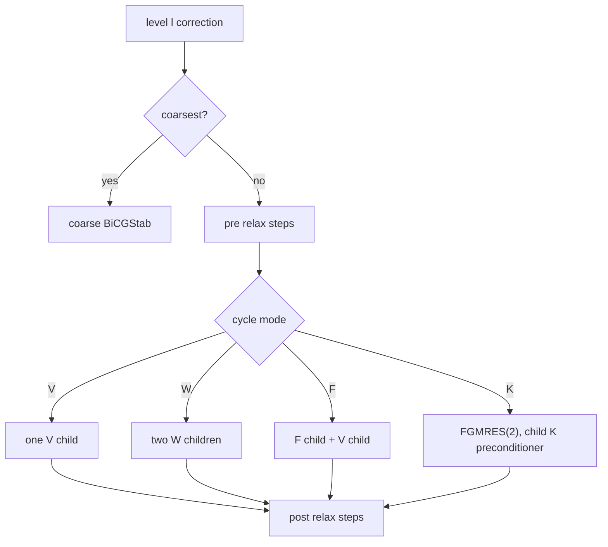

### 算法摘要

- V-cycle：每个层级执行一次 child correction。
- W-cycle：每层对 child 做两次递归校正。
- F-cycle：先用 F 递归，再用 V 递归。
- K-cycle：用短 FGMRES(2) 求解 next-level 方程，每个预条件应用是一次 child K-cycle。

### 同类算法优劣

| cycle | 优点 | 缺点 |
|---|---|---|
| V | 成本最低；常用 | 低频修正能力较弱 |
| W | 粗层修正更强 | 递归成本约指数增长 |
| F | V 与 W 的折中 | 递归路径仍复杂 |
| K | 粗层 Krylov 更强，可提高稳健性 | 额外 FGMRES workspace 和多次递归 |

### 当前采用

- cycle 位互斥。
- 默认 V。
- 2-level 时 level 1 已是最粗层，W/F/K 没有实际差异。

## A14. QCU Coarse Guarded BiCGStab

### 流程图

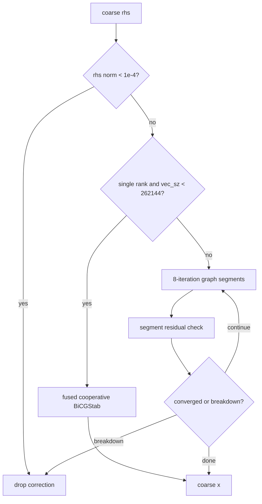

### 算法摘要

粗层使用 guarded BiCGStab，对病态 scalar 更新设置阈值，避免收敛后
$\rho\to0$ 产生 `0/0`。目标锚定到首次进入该层的

$$
\tau_l=\mathrm{tol}_l\,\|r_l^{(0)}\|_2.
$$

### 同类算法优劣

| 方案 | 优点 | 缺点 |
|---|---|---|
| Guarded BiCGStab | 适合非 Hermitian；短内存；可 fused/graph | 需 breakdown guard；固定步可能过迭代 |
| CG | HPD 上更简单 | 非 HPD 粗 Schur 可能发散 |
| GMRES/GCR | 残差更稳健 | 小粗层上内存与 kernel 开销较大 |
| Dense LU | 极粗层可一次求解 | 仅适用极小矩阵；不可扩展 |

### 当前采用

- 最粗层 fused 阈值 `vec_sz < 262144` 且单 rank。
- 多 rank 关闭 cooperative fusion 和 graph。
- 最粗层 `max_iter` 来自 level 参数。
- coarse correction breakdown 时 fine Krylov 继续。

## A15. QCU Initial Deflation

### 流程图

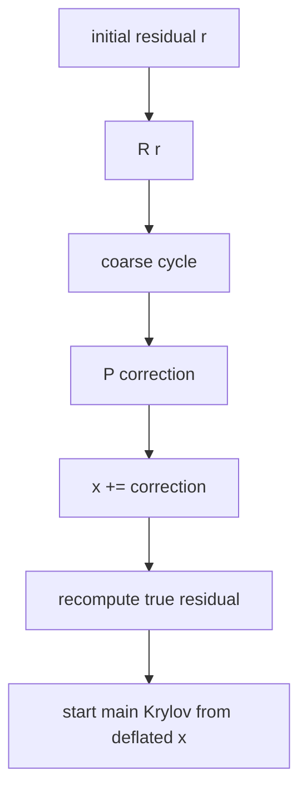

### 算法摘要

一次性粗校正：

$$
x\leftarrow x+P A_c^{-1}P^{H}r,
\qquad
r\leftarrow b-Sx.
$$

### 同类算法优劣

| 方案 | 优点 | 缺点 |
|---|---|---|
| One-time deflation | 先用粗空间消除低模；主循环启动更好 | 多一次 V-cycle；连续谱上可能无收益 |
| Periodic correction | 可持续压制重新出现的低模 | 每次校正破坏 Krylov 状态，需要 reset |
| No deflation | 成本最低 | 低模使外层收敛慢 |

### 当前采用

- `_MG_USE_DEFLATE_` 控制，默认关闭。
- 主要作用于普通 BiCGStab 和 mixed BiCGStab 路径。

## A16. QCU Reliable Residual 与 Adaptive Correction Gate

### 流程图

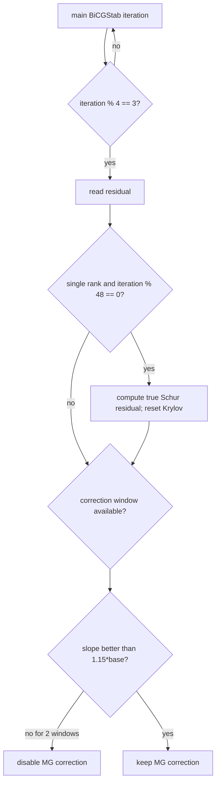

### 算法摘要

校正门控比较纯 BiCGStab 标定斜率 $s_0$ 与启用 MG 后的窗口斜率 $s_1$：

$$
s_0=\frac{\log r_{30}-\log r_0}{30},
$$

$$
s_1=\frac{\log r_{k+12}-\log r_k}{12}.
$$

当 $s_1<1.15s_0$ 连续出现在两个窗口时关闭 MG 校正。

### 同类算法优劣

| 方案 | 优点 | 缺点 |
|---|---|---|
| Adaptive gate | 防止弱粗空间拖慢总体求解 | 前 30 步没有 MG 收益；启发式阈值不保证最优 |
| Always-on correction | 简单；低模有效时收益最大 | 连续谱上可能只增加成本 |
| Never correction | 稳健的 one-level fallback | 放弃潜在低模收益 |
| True residual every iteration | 最可靠 | host/device 同步成本过高 |

### 当前采用

- 检查间隔 4。
- true Schur refresh 为 48 步，且仅单 rank。
- 近收敛时关闭粗校正。
- gate 关闭后当前 solve 不再重新启用。

# 第二部分：QUDA/PyQUDA MG

## B1. QUDA Even-Even MATPC

### 流程图

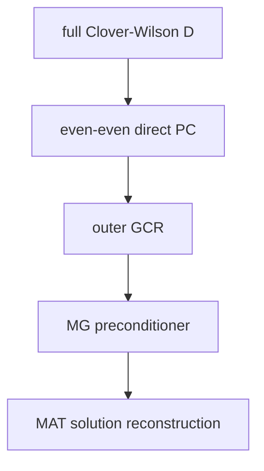

### 算法摘要

当前 PyQUDA 设置：

- `solve_type=DIRECT_PC_SOLVE`。
- `matpc_type=EVEN_EVEN`。
- `solution_type=MAT_SOLUTION`。

对 even-even 预处理，可概念性写作

$$
M_{\mathrm{PC}} =
I-\kappa^2A_{ee}^{-1}D_{eo}A_{oo}^{-1}D_{oe}.
$$

### 同类算法优劣

| 方案 | 优点 | 缺点 |
|---|---|---|
| Even-even MATPC | QUDA 成熟路径；与 MG smoother 兼容 | 需要 Clover inverse；解需 MAT 重构 |
| Odd-odd MATPC | 与 QCU odd Schur 更接近 | 当前 simple 默认不选该方向 |
| Full solve | residual 直接 | 维度更大、条件数通常更差 |

### 当前采用

- fine solve type 为 `DIRECT_PC_SOLVE`。
- outer solution 仍为 `MAT_SOLUTION`。
- simple wrapper 强制 `QUDA_KAPPA_NORMALIZATION`。

## B2. QUDA CGNR Null-Vector Setup

### 流程图

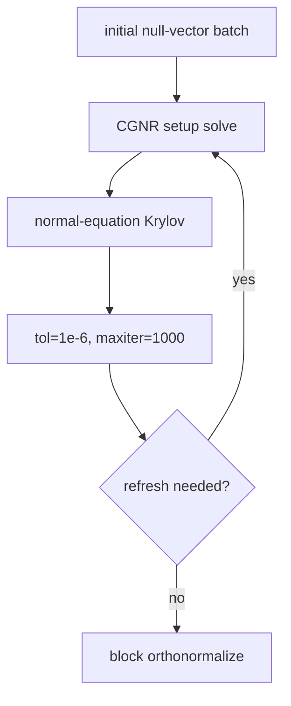

### 算法摘要

当前 `setup_inv_type=CGNR`。CGNR 在最小二乘意义下求解

$$
\min_x\|Ax-b\|_2^2,
$$

等价于迭代

$$
A^{H}Ax=A^{H}b.
$$

### 同类算法优劣

| 方案 | 优点 | 缺点 |
|---|---|---|
| CGNR | 对非 Hermitian $A$ 有明确最小二乘意义；稳定 | 条件数平方；对极端谱收敛慢 |
| Plain CG | HPD 上更快 | 非 Hermitian setup 不适用 |
| GCR/MR | 对非正规算子更稳健 | 内存或成本更高 |
| 直接 Lanczos Ritz | 低模精度高 | 多向量与 setup 成本高 |

### 当前采用

- `setup_tol=1e-6`。
- `setup_maxiter=1000`。
- refresh maxiter=100。
- `n_vec_batch=1`、`num_setup_iter=1`。
- `post_orthonormalize=true`。

## B3. QUDA Aggregate Transfer 与 Block Orthogonalization

### 流程图

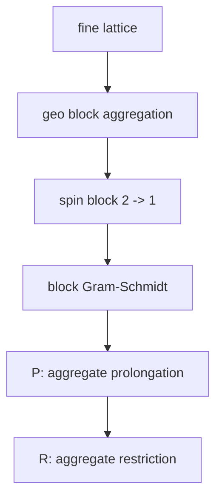

### 算法摘要

fine spin block size 为 2，coarse spin block size 为 1。每个 aggregate 使用
null-vector columns 做局部正交化，然后形成 restriction/prolongation。

### 同类算法优劣

| 方案 | 优点 | 缺点 |
|---|---|---|
| Aggregation | setup 成本低；粗格几何简单；GPU 并行度高 | 粗空间质量依赖 null vectors，通常不如 smoothed aggregation 平滑 |
| Smoothed aggregation | 粗基更平滑，低模质量更好 | setup 更贵；粗算子连接更复杂 |
| Geometric coarsening | 结构最简单 | 不充分吸收规范场和低模信息 |

### 当前采用

- `transfer_type=AGGREGATE`。
- `n_vec=24`，可由 `--nvec` 覆盖。
- coarse color 为 $2n_{\mathrm{vec}}$，默认 48。

## B4. QUDA Galerkin Coarse Operator

### 流程图

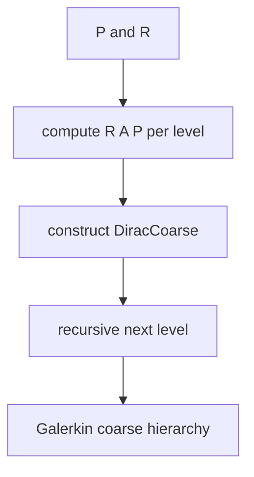

### 算法摘要

粗算子是

$$
A_{l+1}=R_lA_lP_l.
$$

QUDA 使用 aggregate blocked coarse fields，而不是 QCU 的 33-tensor Schur stencil。

### 同类算法优劣

| 方案 | 优点 | 缺点 |
|---|---|---|
| Galerkin `RAP` | 保持细层谱信息；可递归 | setup 和存储成本较高 |
| Rediscretization | 便宜、结构简单 | 不一定表示细算子投影 |
| Matrix-free RAP | 省存储 | 每次 coarse matvec 太贵 |

### 当前采用

- `generate_all_levels=true`。
- 每个 transition 做 Galerkin 粗化。
- `run_verify=true` 检查 transfer/coarse operator。

## B5. QUDA CA-GCR Smoother

### 流程图

```mermaid
flowchart TD
    A["level input"] --> B["communication-avoiding Krylov basis"]
    B --> C["block orthogonalization"]
    C --> D["small Gram solve"]
    D --> E["smoother update"]
    E --> F{"nu_pre/nu_post count?"}
    F -->|"no"| B
    F -->|"yes"| G["return smoothed vector"]
```

### 算法摘要

当前 `smoother=CA-GCR`：

$$
\mathrm{tol}_{\mathrm{smooth}}=0.25,
\qquad
\nu_{\mathrm{pre}}=0,
\qquad
\nu_{\mathrm{post}}=8.
$$

CA-GCR 通过块 Krylov 方向和较少全局同步完成平滑。

### 同类算法优劣

| 方案 | 优点 | 缺点 |
|---|---|---|
| CA-GCR | 对非 Hermitian、强非正规算子稳健；同步较少 | 块 Gram 和小系统开销；参数更复杂 |
| MR | 每个方向残差最小化；简单 | 每步点积；粗层通信仍多 |
| Chebyshev | 无点积；成本低 | 需要好谱界 |
| CG | HPD 上很高效 | MATPC 非 Hermitian 时风险高 |

### 当前采用

- 每层 CA-GCR。
- `nu_pre=0`，只执行 8 次 post-smoothing。
- `smoother_tol=0.25`，属于 sloppy smoother。

## B6. QUDA Recursive Cycle

### 流程图

```mermaid
flowchart TD
    A["level l"] --> B["pre-smoother (0 by default)"]
    B --> C["residual"]
    C --> D["R"]
    D --> E{"terminal?"}
    E -->|"no"| F["coarse GCR wrapper -> level l+1"]
    E -->|"yes"| G["terminal CA-GCR"]
    F --> H["P correction"]
    G --> H
    H --> I["post-smoother 8"]
    I --> J["return correction"]
```

### 算法摘要

QUDA 使用 `cycle_type=RECURSIVE`，不是当前 QCU 默认的固定 V-cycle。每一层组合：

- 当前层级 smoother。
- residual/restrict。
- 递归 coarse level。
- coarse solver wrapper。
- prolong。
- post-smoother。

### 同类算法优劣

| cycle | 优点 | 缺点 |
|---|---|---|
| Recursive | 灵活；由 coarse wrapper 决定递归深度和求解方式 | 行为依赖较多参数，成本不如 V-cycle 容易预估 |
| V | 成本可控，常用 | 对困难低模可能不足 |
| W/F | 粗层修正更强 | 成本和递归深度增加 |

### 当前采用

- `cycle_type[level]=QUDA_MG_CYCLE_RECURSIVE`。
- 默认 pre=0、post=8。
- 每层 coarse wrapper 由 `coarse_solver[level]` 决定。

## B7. QUDA Outer GCR(8)

### 流程图

```mermaid
flowchart TD
    A["r=b-Ax"] --> B["v_j candidate direction"]
    B --> C["z_j=M^-1 v_j"]
    C --> D["w_j=A z_j"]
    D --> E["orthogonalize w_j against previous W"]
    E --> F["carry coefficients to Z"]
    F --> G["Gram / least-squares update"]
    G --> H["x += Z alpha; reliable r"]
    H --> I{"converged?"}
    I -->|"no"| B
    I -->|"yes"| J["return x"]
```

### 算法摘要

GCR 是右预条件的 generalized conjugate residual。对搜索方向 $z_j$ 和 image
$w_j=Az_j$，最小化

$$
\min_{\alpha}\left\|r-\sum_j\alpha_jw_j\right\|_2.
$$

外层使用 8 个 Krylov 方向（`gcrNkrylov=8`），并按 reliable update 读取真残差。

### 同类算法优劣

| 方案 | 优点 | 缺点 |
|---|---|---|
| GCR(8) | 对非 Hermitian 和 MG 右预条件稳健；残差有明确最小化 | 需要保存 Krylov 基；正交化与全局 reduction 多 |
| FGMRES | 同样适合变预条件 | 内存更大；不直接以残差基底更新 |
| BiCGStab | 内存低 | 与非定常 MG 预条件配合需重启 |
| CA-GCR | 降低同步 | 块 Gram 和小系统复杂 |

### 当前采用

- outer `inv_type=GCR`。
- `inv_type_precondition=MG`。
- `gcrNkrylov=8`。
- `precondition_cycle=1`。
- `reliable_delta=1e-5`。

## B8. QUDA GCR Coarse Wrapper 与 Terminal CA-GCR

### 流程图

```mermaid
flowchart TD
    A["MG level l"] --> B["coarse_solver[l]"]
    B --> C{"terminal?"}
    C -->|"no"| D["GCR wraps correction + smoother"]
    C -->|"yes"| E["CA-GCR solves coarse equation"]
    D --> F["next level"]
    E --> G["coarse correction"]
    F --> G
```

### 算法摘要

PyQUDA 当前默认数组：

```text
coarse_solver = [GCR, CA-GCR]
coarse_solver_tol = [0.25, 0.25]
coarse_solver_maxiter = [16, 16]
```

非终端层 GCR 包装粗校正；终端层用 CA-GCR 解粗方程。

### 同类算法优劣

| 方案 | 优点 | 缺点 |
|---|---|---|
| GCR wrapper | 残差性质好；可包住 nonstationary V-cycle | Krylov 基存储较高 |
| CA-GCR terminal | 终端粗层上减少同步 | Gram 矩阵和块方向开销 |
| MR terminal | 简单稳健 | 粗方程可能收敛慢 |
| Direct dense solve | 极小粗层精确 | 不可扩展；不适合 4D coarse field |

### 当前采用

- `coarse_solver_tol=0.25`。
- `coarse_solver_maxiter=16`。
- `coarse_grid_solution_type=MATPC`。
- `smoother_solve_type=DIRECT_PC_SOLVE`。

## B9. QUDA Reliable Update 与验证

### 流程图

```mermaid
flowchart TD
    A["Krylov iteration"] --> B["recursive MG cycle"]
    B --> C["new x and estimated r"]
    C --> D{"reliable_delta threshold?"}
    D -->|"yes"| E["true residual b-Ax"]
    D -->|"no"| F["continue recursive iteration"]
    E --> G["restart/update Krylov state"]
    G --> F
    F --> H["setup/run verification"]
```

### 算法摘要

当前设置：

$$
\texttt{reliable\_delta}=10^{-5},
\qquad
\texttt{residual\_type}=L2\_RELATIVE,
$$

$$
\texttt{tol\_restart}=5000\,\texttt{tol}.
$$

setup 还开启 `run_verify`，用于 transfer/coarse operator 检查。

### 同类算法优劣

| 方案 | 优点 | 缺点 |
|---|---|---|
| Reliable true residual | 防止递推残差漂移造成假收敛 | 增加 matvec 和同步 |
| 仅估计残差 | 快 | 长递推或 fp32 下可能假收敛 |
| 每步 true residual | 最可靠 | 成本过高 |
| 周期 true residual | 成本/可靠性折中 | 周期选择影响鲁棒性 |

### 当前采用

- `reliable_delta=1e-5`。
- `tol_restart=5000*tol`。
- `run_verify=true`。
- `use_init_guess=NO`。

# 第三部分：同类算法横向比较

## C1. Smoother

| 算法 | 收敛稳健性 | 每步成本 | 通信 | 主要适用 |
|---|---:|---:|---:|---|
| CG | 中 | 1 matvec + 点积 | 中 | 近 HPD fine Schur |
| MR | 高 | 1 matvec + 点积 | 中 | 非正规 coarse operator |
| Chebyshev | 中 | 1 matvec，无点积 | 低 | 有可信谱界、通信受限 |
| CA-GCR | 高 | 块 matvec + Gram | 较低同步 | 强非正规、并行规模大 |

## C2. Outer Krylov

| 算法 | 内存 | 变预条件适应性 | 残差单调性 | 实现复杂度 |
|---|---:|---:|---:|---:|
| BiCGStab | 低 | 中 | 不一定 | 低 |
| BiCGStabL(2) | 中 | 中 | 较好 | 中高 |
| FGMRES(10) | 高 | 高 | 较好 | 中 |
| GCR(8) | 高 | 高 | 好 | 中高 |
| CA-GCR | 高 | 高 | 好 | 高 |

## C3. Cycle

| cycle | 粗层工作量 | 低模修正 | 实现复杂度 |
|---|---:|---:|---:|
| V | 1x | 中 | 低 |
| F | 约 2x 递归 | 较高 | 中 |
| W | 约 2x/层 | 高 | 中 |
| K | 额外 FGMRES | 高 | 高 |
| QUDA recursive | 参数驱动 | 高 | 高 |

## C4. 当前默认路径的物理解读

QCU 默认：

$$
\text{Schur BiCGStab}
\;+\;
\text{periodic additive coarse correction}
\;+\;
\text{coarse BiCGStab}.
$$

QUDA 默认：

$$
\text{MATPC}
\;\rightarrow\;
\text{GCR(8)}
\;\rightarrow\;
\text{MG right preconditioner}
\;\rightarrow\;
\text{CA-GCR smoother + recursive coarse wrapper}.
$$

两种算法的外层 Krylov、MG 作用方式、smoother 和粗层求解器均不同。报告中的
iteration 只有在明确外层算法和停机定义后才有可比性。

# 第四部分：源码依据

## QCU

- fine Schur：
  [`lattice_clover_multigrid.h`](../cpp/cuda/qcu/include/lattice_clover_multigrid.h)
- 33-tensor coarse dslash：
  [`lattice_clover_multigrid.h`](../cpp/cuda/qcu/include/lattice_clover_multigrid.h)
- mode bit 解析：
  [`lattice_clover_multigrid.h`](../cpp/cuda/qcu/include/lattice_clover_multigrid.h)
- recursive cycle：
  [`lattice_clover_multigrid.h`](../cpp/cuda/qcu/include/lattice_clover_multigrid.h)
- default BiCGStab：
  [`lattice_clover_multigrid.h`](../cpp/cuda/qcu/include/lattice_clover_multigrid.h)
- fixed-step MG preconditioner：
  [`lattice_clover_multigrid.h`](../cpp/cuda/qcu/include/lattice_clover_multigrid.h)
- FGMRES：
  [`lattice_clover_multigrid.h`](../cpp/cuda/qcu/include/lattice_clover_multigrid.h)
- CA-GCR：
  [`lattice_clover_multigrid.h`](../cpp/cuda/qcu/include/lattice_clover_multigrid.h)
- null-vector builder：
  [`_multigrid.py`](../pyqcu/torch/tools/_multigrid.py)
- local QR：
  [`_multigrid.py`](../pyqcu/torch/tools/_multigrid.py)
- simple defaults：
  [`qcu_multigrid.py`](../pyqcu/testing/simple/qcu_multigrid.py)

## QUDA/PyQUDA

- local QUDA multigrid parameter definition:
  `data/quda-sm70-install/include/quda.h:629`
- local QUDA per-level MG metadata:
  `data/quda-sm70-install/include/multigrid.h:85`
- PyQUDA 0.10.54 MG defaults:
  `pyquda/dirac/general.py:283`
- PyQUDA outer GCR/MG preconditioner:
  `pyquda/dirac/general.py:408`
- PyQUDA `Multigrid.setParam`:
  `pyquda/dirac/general.py:479`
- local simple wrapper:
  [`quda_multigrid.py`](../pyqcu/testing/simple/quda_multigrid.py)

## 版本边界

QUDA/PyQUDA 的默认 MG 算法参数可能随版本变化。本文对应当前
`quda-sm70-install` 的 QUDA `1.1.0-sm70` 与 PyQUDA `0.10.54`。QCU 对应当前
工作区的 legacy CUDA `lattice_clover_multigrid.h`。升级后应重新核对参数表和流程图。
